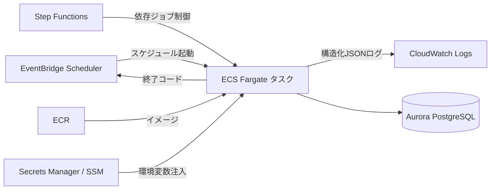

# 方式設計書

本書は本プロジェクトの **SSoT（Single Source of Truth）** である。
設計・実装・レビューの全工程はこの方式設計に準拠すること。本書と実装が乖離した場合は、本書を先に改訂してから実装を変更する（仕様駆動開発）。

## 1. システム構成

### 1.1 実行基盤（AWS）



- バッチは **ECS Fargate タスク** として実行する。1回のタスク実行＝1ジョブ実行
- 起動トリガーは **EventBridge Scheduler**。依存関係のあるジョブフローは **Step Functions** でオーケストレーションする
- ジョブの終了コードは ECS タスクの終了コードへ伝播させ、EventBridge / Step Functions から失敗検知・リラン制御を行う
- 機密情報（DB接続情報・APIキー等）は Secrets Manager / SSM Parameter Store から環境変数として注入する。コード・設定ファイルへの直書きは禁止
- ローカル開発は AWS 非依存で動作する（Docker Compose の PostgreSQL、ファイルシステム入出力）。AWS 依存機能はプロファイルで切り替える

### 1.2 アプリケーション構成

- 1つの実行可能 Jar / コンテナイメージに**全ジョブを同梱**する（Uber-jar 方式）
- 起動時に `spring.batch.job.name` プロパティで実行するジョブを **1つだけ** 選択する

```bash
java -jar batch-sample.jar --spring.batch.job.name=sample01CsvImportJob importDate=2026-07-14,java.time.LocalDate
```

- ECS ではタスク定義の `command` 上書きでジョブ名・パラメータを指定する
- ジョブの追加＝Job Bean の追加であり、インフラ構成の変更を伴わない

## 2. モジュール構成

| モジュール | 役割 | 依存 |
|---|---|---|
| `batch-core` | 基盤部品（共通ライブラリ）。業務に依存しない | Spring Batch / MyBatis / Spring Web |
| `batch-sample` | 業務アプリケーション（サンプル）。ジョブ定義と業務ロジック | `batch-core` |

**原則: 業務モジュールは基盤部品を必ず利用する。** `batch-core` に既にある機能（HTTPクライアント、共通Tasklet、Reader/Writer、リスナー等）を業務側で独自実装してはならない。基盤部品に不足があれば `batch-core` を拡張する。

### 2.1 ジョブ実装のパッケージ構成（業務モジュール）

ジョブ単位のパッケージ（`job01_csv_import` 等）に、そのジョブの構成要素をまとめる（パッケージ・バイ・フィーチャー）。

```
com.example.batch.sample/
├── common/                  # 複数ジョブで共有するエンティティ・Mapper
└── job01_csv_import/
    ├── Sample01JobConfig.java   # Job/Step/Reader/Processor/Writer の Bean 定義
    ├── CustomerCsvRecord.java   # 入力レコード（record 型）
    └── CustomerItemProcessor.java
```

## 3. ジョブ設計方針

### 3.1 Chunk と Tasklet の使い分け

| 観点 | Chunk | Tasklet |
|---|---|---|
| 用途 | 大量データの読取→加工→書込 | 単発処理（ファイル操作・件数チェック・API1回呼出・SQL一括実行） |
| トランザクション | チャンク単位でコミット | Tasklet 全体で1トランザクション |
| リスタート | 処理済みチャンクの続きから再開 | Step 単位で最初から再実行 |
| Skip/Retry | レコード単位で制御可能 | 不可（全体成功 or 全体失敗） |

**判断基準:**
- 入力データが件数無制限（ファイル・テーブル・API ページング）→ **Chunk**
- 集計 SQL 1本で完結する処理（`INSERT ... SELECT`）→ **Tasklet**（DB 内で完結させ、データを Java 側に持ち出さない）
- 前処理・後処理（ファイル存在チェック、退避、通知）→ **Tasklet**

### 3.2 Step 分割の方針

- 1 Step には 1 責務のみ与える（チェック → 本処理 → 後処理 は別 Step にする）
- Step 間のデータ受け渡しは原則 **DB またはファイル** を介す。`ExecutionContext` に載せてよいのは少量のメタ情報（処理対象日、ファイルパス、件数）のみ
- 条件分岐が必要な場合は Flow（`on("COMPLETED")` / カスタム ExitStatus）で表現する

### 3.3 チャンクサイズ

- 初期値は **100** とし、性能測定に基づいて調整する（設定で外部化し、コードに埋め込まない）
- DB 読取は `MyBatisCursorItemReader`（カーソルフェッチ）を基本とし、全件メモリロードを禁止する

## 4. トランザクション方針

- **Chunk Step**: Spring Batch 標準のチャンク単位コミットに従う。Writer 内で手動コミット・ロールバックを行わない
- **Tasklet Step**: Tasklet 全体が1トランザクション。長大な更新は Tasklet にしない（undo ログ肥大・ロック長期化のため）
- **洗い替え（truncate-insert）**: `TRUNCATE` はロールバック可能な PostgreSQL の特性を活かし、truncate と insert を同一 Step（同一Tx）で実行する。途中失敗時は全件ロールバックされ、旧データは残らない点に注意し、参照系への影響が許容できない場合は一時テーブル＋`RENAME` 方式を検討する
- ジョブメタデータ（BATCH_*）のトランザクションは業務トランザクションと同一 DataSource / TransactionManager を使用する（2フェーズコミット回避のため DB は分離しない。スキーマのみ分離する）

## 5. エラー処理方針

### 5.1 例外階層（batch-core で定義）

| 例外 | 意味 | 既定の扱い |
|---|---|---|
| `BusinessException` | 業務エラー（入力データ不正等）。データを直せば解消する | **Skip 対象**（閾値超過で異常終了） |
| `SystemException` | システムエラー（DB断・設定不備等）。環境を直さないと解消しない | 即時異常終了 |
| `RetryableSystemException` | 一時的システムエラー（API タイムアウト等） | **Retry 対象**（リトライ枯渇で異常終了） |

### 5.2 Skip / Retry

- Skip は `BusinessException` 系のみ許可し、`skipLimit`（既定10件）を必ず設定する
- Skip したレコードは **エラーレコードファイル**（元レコード＋エラー理由）へ退避し、後続の手動リカバリを可能にする
- Retry は `RetryableSystemException` 系のみ許可し、リトライ回数（既定3回）・間隔は設定で外部化する
- HTTP 呼出のリトライは HTTP Client 基盤（指数バックオフ）で行い、Batch の Retry と二重にしない

### 5.3 警告終了

- Skip が1件以上発生してジョブが完走した場合は **警告終了（終了コード2）** とし、運用で気付けるようにする

## 6. リラン設計

### 6.1 リスタート（途中再開）

- Spring Batch のリスタート機構を標準とする。失敗ジョブを**同一 JobParameters で再実行**すると、失敗した Step から（Chunk Step は処理済みチャンクの続きから）再開される
- Reader は状態を `ExecutionContext` に保存できる実装（`FlatFileItemReader` / `MyBatisCursorItemReader` 等）を使用する
- **成功済みジョブの同一パラメータ再実行はエラーになる**のが正しい挙動（誤操作防止）。意図的な再処理は業務パラメータ（処理対象日等）を変えて実行する

### 6.2 冪等性

- 取込ジョブは「同一入力の再実行で結果が変わらない」ことを保証する（キー重複時は UPSERT、または洗い替え）
- 抽出ジョブは出力ファイルを上書き生成する（追記しない）

### 6.3 二重起動防止

- 同一ジョブの並行実行は基盤部品のジョブ実行制御（実行中チェック）で防止する
- スケジューラ側（EventBridge）でも同時実行しない設定とする（多層防御）

## 7. 終了コード規約

| 終了コード | 意味 | ExitStatus | 運用アクション |
|---|---|---|---|
| 0 | 正常終了 | COMPLETED | なし |
| 2 | 警告終了（Skip 発生等、完走したが要確認） | COMPLETED_WITH_WARNING | エラーレコードファイルを確認 |
| 1 | 異常終了 | FAILED | 原因除去後、同一パラメータでリスタート |

- `ExitCodeMapper` で ExitStatus → プロセス終了コードへ変換し、`System.exit(SpringApplication.exit(...))` で ECS タスクへ伝播する
- Step Functions / EventBridge は終了コード 0 以外を失敗として扱う

## 8. ロギング・監視方針

- ログは**構造化 JSON**（Spring Boot ネイティブ structured logging, ECS 形式）で標準出力へ出力し、awslogs ドライバで CloudWatch Logs へ送る
- プロファイル `local` はテキスト形式（開発時の可読性優先）、`dev` / `prod` は JSON 形式
- 基盤部品の `JobExecutionListener` / `StepExecutionListener` により、以下を**全ジョブ共通で自動出力**する:
  - ジョブ/Step の開始・終了、所要時間
  - 読取件数・書込件数・Skip 件数・コミット回数
  - 終了ステータス、失敗時の例外情報
- 業務ログにはジョブ名・実行IDが MDC で付与される
- ログレベル: 業務エラー=WARN、システムエラー=ERROR、通常進捗=INFO。個人情報・機密情報のログ出力は禁止

## 9. データベース方針

### 9.1 スキーマ分離

| スキーマ | 内容 | 管理 |
|---|---|---|
| `batch` | Spring Batch メタデータ（BATCH_* テーブル） | Flyway（`db/migration/batch`） |
| `app` | 業務テーブル | Flyway（`db/migration/app`） |

- Spring Boot の自動メタデータ生成（`spring.batch.jdbc.initialize-schema`）は **無効化**し、Flyway のマイグレーションで明示管理する（本番で DDL 権限を持たない運用を想定）
- 接続ユーザーは両スキーマへのアクセス権を持つ。`currentSchema` は指定せず、SQL 側でスキーマ修飾する
- **重要（Boot 4）:** Spring Batch 6 / Boot 4 の既定 JobRepository は**インメモリ（Resourceless）**であり、
  そのままではメタデータが永続化されずリスタートできない。バッチアプリは必ず
  `spring-boot-starter-batch-jdbc` を依存に追加して JDBC ジョブリポジトリを有効化すること

### 9.2 DB アクセス

- MyBatis を標準とする。SQL は Mapper XML（`src/main/resources/mapper/`）に記述し、アノテーション SQL は使わない（レビュー性・SQL 資産管理のため）
- 大量読取は `MyBatisCursorItemReader`、書込は `MyBatisBatchItemWriter`（バッチ実行モード）を基本とする
- 集計は SQL（`INSERT ... SELECT`）で行い、Java 側での集計ループを避ける

## 10. 設定管理

- プロファイル: `local`（既定・AWS 非依存）/ `dev` / `prod`
- 環境差分（接続先・チャンクサイズ・リトライ回数・ファイルパス）は `application-{profile}.yml` に外部化する
- 機密情報は環境変数参照（`${DB_PASSWORD}`）とし、AWS では Secrets Manager から注入する。`local` のみ compose の固定値を使用
- 業務定数はタイプセーフな `@ConfigurationProperties` クラス（batch-core の設定管理部品）で受ける

## 11. 命名規約

| 対象 | 規約 | 例 |
|---|---|---|
| ジョブ名（Bean名） | `{サンプル番号}{内容}Job`（camelCase） | `sample01CsvImportJob` |
| Step 名 | `{ジョブ名}.{連番}{内容}Step` | `sample01.01ImportStep` |
| ジョブパッケージ | `jobNN_{内容}`（snake_case） | `job01_csv_import` |
| Job 設定クラス | `SampleNNJobConfig` | `Sample01JobConfig` |
| Reader/Processor/Writer Bean | `{ジョブ名}{役割}` | `sample01CustomerReader` |
| Mapper XML | `{エンティティ}Mapper.xml` | `CustomerMapper.xml` |
| Flyway | `V{連番}__{内容}.sql`（内容は英語 snake_case） | `V2__create_customer.sql` |
| ジョブパラメータ | camelCase。日付は `java.time.LocalDate` 型 | `importDate` |

- 終了コード・ExitStatus のカスタム値は `COMPLETED_WITH_WARNING` のみ許可（乱立防止）
- テーブル・カラム名は snake_case、テーブル名は複数形にしない

## 12. テスト方針

| レベル | 対象 | 手段 |
|---|---|---|
| 単体テスト | Processor / Tasklet / 部品クラス | JUnit 5 + Mockito（Spring コンテキスト非使用） |
| 結合テスト | ジョブ全体（`*IT.java`） | `@SpringBatchTest` + Testcontainers（PostgreSQL 16、本番同一バージョン） |

- 結合テストはジョブを実際に起動し、DB/ファイルの結果と `ExitStatus` を検証する
- カバレッジ閾値: 命令カバレッジ 80%（JaCoCo。骨格サンプルは対象外）
- テストデータは各テストが自前で用意し、テスト間の依存を作らない

## 13. Spring Batch 6 実装上の注意

Spring Batch 6 は 5 系から API が変わっている。**Web 上の 5 系以前のサンプルコードを流用しない**こと。

- ジョブ起動は `JobOperator` を使用する（`JobLauncher` は 6.0 で非推奨）
- `@EnableBatchProcessing` は Boot の自動構成を無効化するため、Boot アプリでは **付けない**
- Builder（`StepBuilder` / `JobBuilder`）は `JobRepository` をコンストラクタで受け、チャンク定義は `.chunk(size, transactionManager)` 形式
- メタデータテーブル DDL は 6 系同梱のものを使用する（5 系からスキーマ変更あり）
- 実装前に必ず公式リファレンス（<https://docs.spring.io/spring-batch/reference/>）で 6 系のシグネチャを確認する
