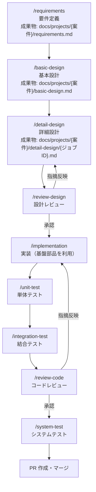

# 開発ガイド

本書は、この雛形を使って案件開発を進めるための手順書である。
開発は Claude Code と工程別 Skills（`.claude/skills/`）を用いた **SDD（仕様駆動開発）** で進める。

## 1. 環境構築

### 1.1 前提ツール

| ツール | バージョン | 備考 |
|---|---|---|
| JDK | 25（Temurin） | `java -version` で確認 |
| Docker | 最新 | Docker Desktop 等。結合テスト・ローカルDB で必須 |
| Git / GitHub CLI | 最新 | `gh auth login` 済みであること |
| Claude Code | 最新 | 標準開発環境 |

Maven はリポジトリ同梱の Maven Wrapper（`./mvnw`、3.10.0 固定）を使用するためインストール不要。

### 1.2 初回セットアップ

```bash
git clone https://github.com/nagashima-toru/spring-batch-ai-coding-samples.git
cd spring-batch-ai-coding-samples

# ローカルDB（PostgreSQL 16）起動
docker compose -f docker/compose.yaml up -d

# ビルド＋全テスト（初回は依存ダウンロードで数分かかる）
./mvnw verify
```

### 1.3 よく使うコマンド

```bash
./mvnw verify                 # ビルド＋単体＋結合＋静的解析＋カバレッジ
./mvnw verify -DskipITs       # 結合テスト（Docker 必須）を除外
./mvnw test -pl batch-core    # モジュール指定で単体テストのみ
./mvnw checkstyle:check       # 規約チェックのみ

# サンプルジョブのローカル実行（プロファイル local）
./mvnw spring-boot:run -pl batch-sample \
  -Dspring-boot.run.arguments="--spring.batch.job.name=sample01CsvImportJob importDate=2026-07-14,java.time.LocalDate"
```

## 2. 開発の進め方（工程と Skills）

各工程は Claude Code の Skill として定義されている。**前工程の成果物（Markdown）を入力とし、次工程の成果物を生成する**ことでドキュメントが連鎖し、設計書が常に SSoT となる。

### 2.1 工程フロー



`implementation` / `unit-test` / `integration-test` の各工程は、§5 の**検証ループ**（検証→失敗なら修正→再検証）を工程内に内蔵する。

**設計意図: システムテストを PR 作成の前に置く理由**

システムテストのシナリオ・テストデータ・実施記録（`docs/projects/{案件}/system-test/`）も設計成果物であり、
実装コードと同じ PR でレビューできる状態にする。運用観点（リラン・異常終了時の運用）の不備が見つかった場合、
マージ前であれば同じ PR 内で実装を直せる（マージ後だと修正が別 PR に分かれ、トレーサビリティが落ちる）。

### 2.2 各工程の入出力

| 工程（Skill） | 入力 | 出力 |
|---|---|---|
| `requirements` | ヒアリング内容・既存資料 | `docs/projects/{案件}/requirements.md` |
| `basic-design` | requirements.md | `docs/projects/{案件}/basic-design.md`（ジョブ一覧・方式・IF・テーブル設計） |
| `detail-design` | basic-design.md | `docs/projects/{案件}/detail-design/{ジョブID}.md`（Step 構成・処理フロー・エラー処理） |
| `review-design` | 設計書＋`docs/architecture.md` | レビュー指摘（設計書へ反映） |
| `implementation` | detail-design/{ジョブID}.md | ジョブ実装コード（基盤部品を利用） |
| `unit-test` | 実装コード＋詳細設計書 | JUnit 5 単体テスト |
| `integration-test` | 実装コード＋詳細設計書 | Testcontainers 結合テスト（`*IT.java`） |
| `review-code` | 実装＋テスト＋`docs/coding-standards.md` | レビュー指摘（コードへ反映） |
| `system-test` | basic-design.md・運用設計 | テストシナリオ・データ・実施結果 |

**設計意図: `basic-design.md` は案件単位で1ファイル、`detail-design/` はジョブ単位で複数ファイルにしている理由**

基本設計と詳細設計では扱う粒度が異なるため、成果物のファイル分割方針も意図的に変えている。

- **基本設計（`basic-design.md`、単一ファイル）**: ジョブ分割・IF設計・テーブル設計は案件全体を俯瞰して決める内容であり、
  ジョブ間の関係（先行/後続、共有テーブル）も含めて1つの文書で一望できる必要がある。§1「ジョブ一覧」に
  案件内の全ジョブを列挙し、§2「ジョブ方式設計」でジョブごとに節を繰り返す構成にしているのはこのため
  （`templates/basic-design-template.md` 参照。案件のジョブが1本でも複数本でもこの1ファイルにまとめる）。
- **詳細設計（`detail-design/{ジョブID}.md`、ジョブ単位で分割）**: Step構成・処理フロー・エラー処理設計は
  実装可能な粒度までジョブ固有に踏み込むため内容が肥大化しやすく、1ファイルに複数ジョブを詰め込むとレビュー・
  実装時の参照性が落ちる。基本設計のジョブ一覧に載っているジョブの数だけ、`{ジョブID}.md` を作成する
  （`detail-design` Skill は「基本設計書のジョブ**1本**を入力に」実行する設計になっている）。

### 2.3 実行例（新規ジョブを1本作る場合）

```text
# Claude Code 上で対話的に進める
> /requirements 売上データ日次取込バッチの要件を整理したい
> /basic-design docs/projects/sales/requirements.md から基本設計を作成して
> /detail-design SALES-001 のジョブ詳細設計を作成して
> /review-design docs/projects/sales/detail-design/SALES-001.md をレビューして
> /implementation SALES-001 を実装して
> /unit-test SALES-001 の単体テストを作成して
> /integration-test SALES-001 の結合テストを作成して
> /review-code job_sales_import 配下をレビューして
> /system-test sales 案件のシステムテストのシナリオを設計して実施して
```

要件定義書が確定済みなら、上記の `/basic-design` 以降を `/sdd-pipeline` で一括実行できる
（`.claude/skills/sdd-pipeline/SKILL.md`）。

## 3. ブランチ運用・PR

**GitHub Flow** を採用する。

1. `main` から feature ブランチを切る（`feature/{issue番号}-{内容}`。対応する Issue が無い場合は
   `feature/{案件名}`）
2. 実装・テスト。コミットメッセージは日本語で「何を・なぜ」を書く
3. `./mvnw verify` がローカルで通ることを確認（システムテストまで完了した最終状態で通すこと。§2.1）
4. PR を作成（テンプレートに従い、**設計書へのリンク**と**レビュー Skill 実行結果**を記載）
5. CI（build / test / 静的解析 / カバレッジ）が成功し、レビュー承認後にマージ


## 4. 新しいジョブを追加するときのチェックリスト

- [ ] 詳細設計書（`docs/projects/{案件}/detail-design/`）が存在し、レビュー済みである
- [ ] ジョブパッケージ名・Bean 名が命名規約（`docs/architecture.md` §11）に従っている
- [ ] Reader/Writer/Tasklet は batch-core の基盤部品を利用している（独自実装していない）
- [ ] Skip/Retry・エラーレコード退避が方式設計 §5 に従っている
- [ ] `JobParametersValidator` でパラメータ検証している
- [ ] Flyway マイグレーションを追加した（既存ファイルの変更は禁止）
- [ ] 単体テスト＋結合テストがあり、`./mvnw verify` が通る
- [ ] リスタート動作（途中失敗→同一パラメータ再実行）を結合テストまたは手動で確認した

## 5. 検証ループ（自律検証の共通ルール）

`implementation` / `unit-test` / `integration-test` の各 Skill は、成果物を生成したら
**検証コマンドを実行し、失敗したら修正して再検証するループ**を工程内で回す。
本節がループ運用の共通ルール（SSoT）であり、各 Skill は本節を参照する。

### 5.1 ループの基本形

```text
検証コマンド実行 → 失敗（exit code 非0）
  → レポート/ログを読んで原因を特定 → 修正 → 再実行
```

失敗の詳細は以下を読む（標準出力のスタックトレースだけで判断しない）。

| 検証 | レポートの場所 |
|---|---|
| 単体テスト | `{module}/target/surefire-reports/` |
| 結合テスト | `{module}/target/failsafe-reports/` |
| カバレッジ | `{module}/target/site/jacoco/` |
| Checkstyle / SpotBugs | `{module}/target/site` 配下のレポート |

### 5.2 上限と終了条件

- 成功（exit code 0）で終了する。
- 1工程あたり**最大3ラウンド**（カバレッジ充足ループのみ最大2ラウンド）。

### 5.3 早期エスカレーション

同一のエラー（同じテストの失敗・同じ違反）が**2ラウンド連続で解消しない**場合は、
上限に達していなくてもループを停止し、以下を添えてユーザーに報告する。

1. エラーログの要点（該当テスト名・違反内容・スタックトレースの核心）
2. 試した修正の内容
3. 原因の仮説

**モデル昇格（サブエージェント実行時の例外）**: 下位モデル（Sonnet 等）のサブエージェントが工程を
実行していて上記の停止条件に達した場合は、ユーザーへ報告する代わりに、同じ入力で**上位モデル（Opus）の
サブエージェントへ昇格して再試行**してよい（推論不足が原因のケースを救うため）。ただし
**昇格は1回まで・昇格後は最大2ラウンド**とし、それでも解消しなければ上記1〜3を添えてユーザーに報告する。
主エージェント自身が実行している場合、および昇格後も解消しない場合は、昇格せずに報告する。

### 5.4 反則の禁止（ガードレール）

**ループを通すために検証自体を弱めてはならない。** 以下は指摘・依頼がない限り禁止。

- カバレッジ閾値（親 pom の `jacoco.coverage.minimum`）の変更
- Checkstyle / SpotBugs の除外設定追加による回避（正当な抑止はユーザー了承後に理由コメント付きで）
- テストの削除・`@Disabled` 化・アサーション弱体化による回避
- 適用済み Flyway マイグレーションファイルの書き換えによる回避

### 5.5 SSoT との関係

修正の過程で**設計書と異なる実装が必要**と判明したら、ループを中断して先に設計書の
改訂を提案する（設計書と異なる実装の禁止。CLAUDE.md・§2 の原則）。

## 6. トラブルシューティング

| 事象 | 対処 |
|---|---|
| 結合テストが `Could not find a valid Docker environment` で失敗 | Docker Desktop を起動する。急ぎのビルドは `-DskipITs` |
| 「A job instance already exists and is complete」 | 成功済みジョブと同一パラメータで再実行している（`docs/architecture.md` §6.1 の正常挙動）。業務パラメータを変えるか、テストなら DB を初期化する |
| ローカルDB の状態を初期化したい | `docker compose -f docker/compose.yaml down -v && docker compose -f docker/compose.yaml up -d` |
| Checkstyle/SpotBugs 違反でビルド失敗 | `target/site` のレポートを確認し修正する。抑止が妥当な場合のみ理由コメント付きで除外設定へ追加 |
