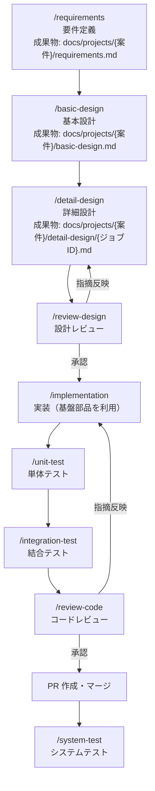

# 開発ガイド

本書は、この雛形を使って案件開発を進めるための手順書である。
開発は Claude Code と工程別 Skills（`.claude/skills/`）を用いた **SDD（仕様駆動開発）** で進める。

## 1. 環境構築

### 1.1 前提ツール

| ツール | バージョン | 備考 |
|---|---|---|
| JDK | 25（Temurin） | `java -version` で確認 |
| Docker | 最新 | Docker Desktop 等。結合テスト・ローカルDB で必須 |
| Git / GitHub CLI | 最新 | `gh auth login` 済みであること |
| Claude Code | 最新 | 標準開発環境 |

Maven はリポジトリ同梱の Maven Wrapper（`./mvnw`、3.9.16 固定）を使用するためインストール不要。

### 1.2 初回セットアップ

```bash
git clone https://github.com/nagashima-toru/spring-batch-ai-coding-samples.git
cd spring-batch-ai-coding-samples

# ローカルDB（PostgreSQL 16）起動
docker compose -f docker/compose.yaml up -d

# ビルド＋全テスト（初回は依存ダウンロードで数分かかる）
./mvnw verify
```

### 1.3 よく使うコマンド

```bash
./mvnw verify                 # ビルド＋単体＋結合＋静的解析＋カバレッジ
./mvnw verify -DskipITs       # 結合テスト（Docker 必須）を除外
./mvnw test -pl batch-core    # モジュール指定で単体テストのみ
./mvnw checkstyle:check       # 規約チェックのみ

# サンプルジョブのローカル実行（プロファイル local）
./mvnw spring-boot:run -pl batch-sample \
  -Dspring-boot.run.arguments="--spring.batch.job.name=sample01CsvImportJob importDate=2026-07-14,java.time.LocalDate"
```

## 2. 開発の進め方（工程と Skills）

各工程は Claude Code の Skill として定義されている。**前工程の成果物（Markdown）を入力とし、次工程の成果物を生成する**ことでドキュメントが連鎖し、設計書が常に SSoT となる。

### 2.1 工程フロー



### 2.2 各工程の入出力

| 工程（Skill） | 入力 | 出力 |
|---|---|---|
| `requirements` | ヒアリング内容・既存資料 | `docs/projects/{案件}/requirements.md` |
| `basic-design` | requirements.md | `docs/projects/{案件}/basic-design.md`（ジョブ一覧・方式・IF・テーブル設計） |
| `detail-design` | basic-design.md | `docs/projects/{案件}/detail-design/{ジョブID}.md`（Step 構成・処理フロー・エラー処理） |
| `review-design` | 設計書＋`docs/architecture.md` | レビュー指摘（設計書へ反映） |
| `implementation` | detail-design/{ジョブID}.md | ジョブ実装コード（基盤部品を利用） |
| `unit-test` | 実装コード＋詳細設計書 | JUnit 5 単体テスト |
| `integration-test` | 実装コード＋詳細設計書 | Testcontainers 結合テスト（`*IT.java`） |
| `review-code` | 実装＋テスト＋`docs/coding-standards.md` | レビュー指摘（コードへ反映） |
| `system-test` | basic-design.md・運用設計 | テストシナリオ・データ・実施結果 |

### 2.3 実行例（新規ジョブを1本作る場合）

```text
# Claude Code 上で対話的に進める
> /requirements 売上データ日次取込バッチの要件を整理したい
> /basic-design docs/projects/sales/requirements.md から基本設計を作成して
> /detail-design SALES-001 のジョブ詳細設計を作成して
> /review-design docs/projects/sales/detail-design/SALES-001.md をレビューして
> /implementation SALES-001 を実装して
> /unit-test SALES-001 の単体テストを作成して
> /integration-test SALES-001 の結合テストを作成して
> /review-code job_sales_import 配下をレビューして
```

## 3. ブランチ運用・PR

**GitHub Flow** を採用する。

1. `main` から feature ブランチを切る（`feature/{issue番号}-{内容}`）
2. 実装・テスト。コミットメッセージは日本語で「何を・なぜ」を書く
3. `./mvnw verify` がローカルで通ることを確認
4. PR を作成（テンプレートに従い、**設計書へのリンク**と**レビュー Skill 実行結果**を記載）
5. CI（build / test / 静的解析 / カバレッジ）が成功し、レビュー承認後にマージ


## 4. 新しいジョブを追加するときのチェックリスト

- [ ] 詳細設計書（`docs/projects/{案件}/detail-design/`）が存在し、レビュー済みである
- [ ] ジョブパッケージ名・Bean 名が命名規約（`docs/architecture.md` §11）に従っている
- [ ] Reader/Writer/Tasklet は batch-core の基盤部品を利用している（独自実装していない）
- [ ] Skip/Retry・エラーレコード退避が方式設計 §5 に従っている
- [ ] `JobParametersValidator` でパラメータ検証している
- [ ] Flyway マイグレーションを追加した（既存ファイルの変更は禁止）
- [ ] 単体テスト＋結合テストがあり、`./mvnw verify` が通る
- [ ] リスタート動作（途中失敗→同一パラメータ再実行）を結合テストまたは手動で確認した

## 5. トラブルシューティング

| 事象 | 対処 |
|---|---|
| 結合テストが `Could not find a valid Docker environment` で失敗 | Docker Desktop を起動する。急ぎのビルドは `-DskipITs` |
| 「A job instance already exists and is complete」 | 成功済みジョブと同一パラメータで再実行している（§6.1 の正常挙動）。業務パラメータを変えるか、テストなら DB を初期化する |
| ローカルDB の状態を初期化したい | `docker compose -f docker/compose.yaml down -v && docker compose -f docker/compose.yaml up -d` |
| Checkstyle/SpotBugs 違反でビルド失敗 | `target/site` のレポートを確認し修正する。抑止が妥当な場合のみ理由コメント付きで除外設定へ追加 |
